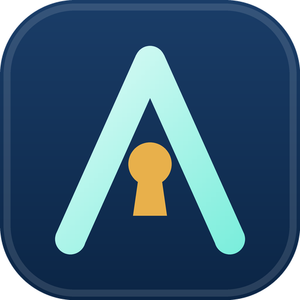

<p align="center">
  
</p>

<h1 align="center">Securing AI agents and MCP servers with Keycloak</h1>

<p align="center">
  mTLS proves who the agent is. DPoP proves it holds the key. A leaked agent token, on its own, gets an attacker nothing.<br>
  <a href="https://australianiamsolutions.com">Australian IAM Solutions</a>
</p>

---

An MCP server that only trusts agents with a certificate from your CA, and only accepts Keycloak tokens that are meant for it, scoped per tool, and bound to the calling agent's key. An agent built on the MCP TypeScript SDK that has no client secret at all. Tested on Keycloak 26.4.0, Node 22 and `@modelcontextprotocol/sdk` 1.32.1.

| Path | What it is |
|---|---|
| `make-certs.sh` | Demo PKI: a CA, one server cert, `notes-agent` and `support-agent` certs, and a rogue agent from an untrusted CA |
| `setup-realm.sh` | Realm `acme`: scopes `notes:read`/`notes:write` with the MCP server as audience; agents with X.509 auth and DPoP-bound tokens |
| `mcp-server/server.mjs` | Notes MCP server: mTLS check, protected resource metadata, token + DPoP proof + audience + scope checks |
| `agent/agent.mjs` | The agent: discovers Keycloak from the 401, gets a token with its cert + a DPoP proof, calls tools |
| `attacker-proof.mjs` | Signs a valid DPoP proof with someone else's key, to show a leaked token is rejected |

```bash
npm install
./make-certs.sh
docker network create kc-agents
docker run -d --name keycloak --network kc-agents -p 9443:8443 -v ./certs:/certs \
  -e KC_BOOTSTRAP_ADMIN_USERNAME=admin -e KC_BOOTSTRAP_ADMIN_PASSWORD=admin \
  -e KC_HTTPS_CERTIFICATE_FILE=/certs/server.crt -e KC_HTTPS_CERTIFICATE_KEY_FILE=/certs/server.key \
  -e KC_HTTPS_TRUST_STORE_FILE=/certs/truststore.p12 -e KC_HTTPS_TRUST_STORE_PASSWORD=changeit \
  -e KC_HTTPS_CLIENT_AUTH=request -e KC_HOSTNAME=https://localhost:9443 \
  quay.io/keycloak/keycloak:26.4.0 start-dev
KC_ADMIN_PASSWORD=admin ./setup-realm.sh
docker run -d --name notes-mcp --network kc-agents -p 9444:9444 -v .:/app -w /app \
  -e ISSUER=https://localhost:9443/realms/acme -e JWKS_URL=https://keycloak:8443/realms/acme/protocol/openid-connect/certs \
  node:22-alpine node mcp-server/server.mjs
mkdir -p logs && DEBUG_LOG=logs/agent.log AGENT=notes-agent node agent/agent.mjs
```

`DEBUG_LOG` makes the agent write its token to a log file, the kind of leak that happens in real deployments. Use it to try the attacks in the handbook playbook.

## What gets refused

| Attempt | Result |
|---|---|
| `notes-agent` deletes a note (it only has `notes:read`) | `insufficient_scope: notes-agent needs notes:write` |
| Leaked token, no client certificate | 403 `no client certificate` |
| Leaked token, another trusted agent's cert, as `Bearer` | 401 `expected the DPoP scheme` |
| Leaked token, another agent's cert + its own DPoP key | 401 `token is not bound to your key` |
| Rogue agent (untrusted CA) at the MCP server | 403 `certificate not signed by our CA` |
| Rogue agent at Keycloak | TLS refused (`certificate unknown`) |
| `support-agent`'s own valid token at the notes MCP server | 401 `token is not for this MCP server (aud)` |

## Gotcha: the MCP SDK and DPoP challenges

The SDK's `extractWWWAuthenticateParams` only reads `Bearer` challenges. A server that requires DPoP answers with a `DPoP` challenge, so the agent parses `resource_metadata` itself, then uses the SDK's `discoverOAuthProtectedResourceMetadata` and `discoverAuthorizationServerMetadata` as normal.

## Builds on

- Keycloak mTLS client auth (episode 3): certificates instead of client secrets
- [sashyo/keycloak-dpop-demo](https://github.com/sashyo/keycloak-dpop-demo) (episode 4): DPoP-bound tokens

Demo only: `start-dev`, a throwaway CA, world-readable keys in `certs/`, and an in-memory replay cache.

## License

Apache 2.0.
